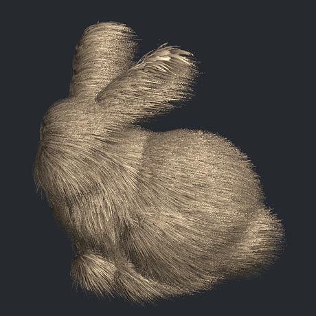
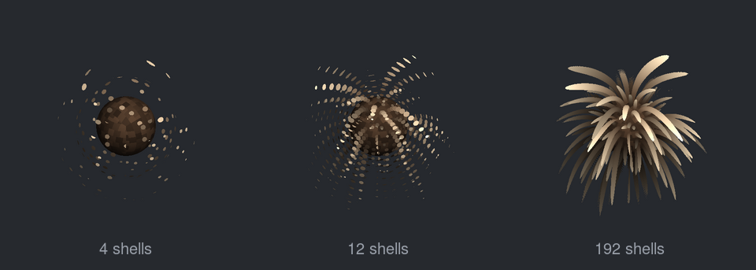

# fur-shell-texturing

Real-time fur on the [tanford bunny, made for the advanced OpenGL course at EPITA.



The fur uses shell texturing. The mesh is drawn 64 times with instancing, each copy pushed out a bit along the normal, and the fragment shader only keeps small discs on each layer. Stacked up, the discs look like strands. Games like Dark Souls (Sif's fur) and Genshin Impact use the same trick, Acerola has a [good video](https://www.youtube.com/watch?v=9dr-tRQzij4) about it.



Each vertex also has a strand tip simulated in a compute shader (Verlet integration, a spring back to the rest position, gravity and value noise wind). The shells bend along a curve from the root to that tip, so the whole fur moves.


Shells look thin from the side, so a geometry shader adds fins on the silhouette, like in Lengyel et al.

## Build

Linux only, needs OpenGL 4.5.

```sh
# Ubuntu / Debian
sudo apt install build-essential libglew-dev freeglut3-dev
# Fedora
sudo dnf install gcc-c++ make glew-devel freeglut-devel
# Arch
sudo pacman -S base-devel glew freeglut
```

```sh
make
./main          # bunny
./main --ball   # long-haired ball
```

Run it from the repo folder, the shaders are loaded from there.

## Controls

```
left / right   rotate
up / down      fur length
+ / -          number of shells
D / d          strand density
f              fins on / off
t              swing
, / .          wind
```

## Reading

- [Real-Time Fur over Arbitrary Surfaces](https://hhoppe.com/proj/fur/), Lengyel et al. 2001
- [Fur (using Shells and Fins)](https://developer.download.nvidia.com/SDK/10.5/direct3d/Source/Fur/doc/FurShellsAndFins.pdf), NVIDIA 2007
- [Rendering Fur with Three Dimensional Textures](https://history.siggraph.org/learning/rendering-fur-with-three-dimensional-textures-by-kajiya-and-kay), Kajiya and Kay 1989
- [Advanced Character Physics](https://www.gamedeveloper.com/programming/advanced-character-physics), Jakobsen 2001
- [How Do Games Render Fur?](https://www.youtube.com/watch?v=9dr-tRQzij4), Acerola
